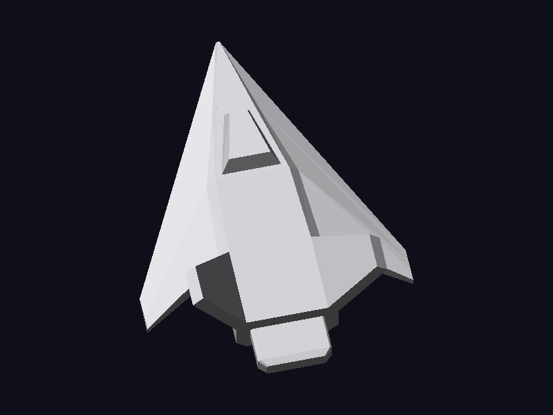

# Proyecto 1 — Software Renderer: cargar un OBJ y pintar sus triángulos

Renderer por software en **Rust** (`minifb` + `nalgebra-glm`). Carga una nave low-poly
hecha en Blender (OBJ triangulado, 96 vértices / 188 triángulos) y dibuja **todos** sus
triángulos recorriendo las caras y usando los índices para obtener los 3 vértices de cada una.



## Cómo funciona

1. `src/obj.rs`: lee `v x y z` y `f a/b/c ...` (índices desde 1 → se resta 1).
2. `src/main.rs` (`render`): gira los vértices, calcula el centro y escala para que la nave
   quede centrada ocupando ~80 % de la ventana, y recorre todas las caras.
3. `src/triangle.rs`: `triangle(fb, a, b, c)` rellena un triángulo (coordenadas baricéntricas).
4. `src/framebuffer.rs`: buffer de píxeles (`clear`, `point`, colores) y guardado a PNG.

Las caras se pintan de lejos a cerca (primero las traseras) con sombreado plano.

## Uso

```bash
cargo run --release                       # abre la ventana (Esc sale, S guarda render.png)
cargo run --release -- --save render.png  # solo genera la imagen
cargo run --release -- models/nave.obj    # otro modelo
```

Ejecutar desde la carpeta del proyecto. Los ángulos de vista se cambian con
`VIEW_PITCH` y `VIEW_YAW` en `src/main.rs`.
